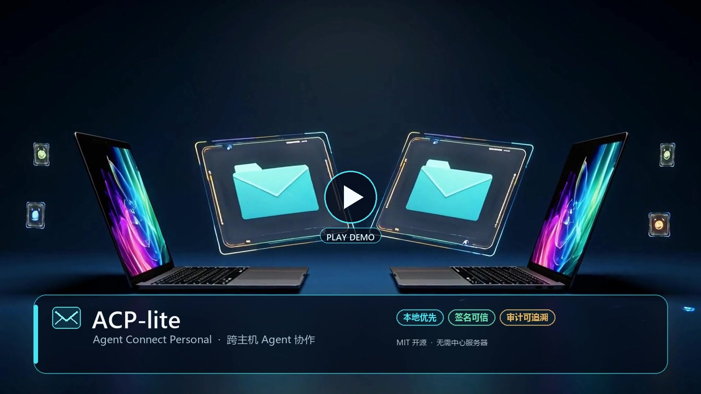

# FreeVideo 本地部署实测与分析

> 本文以绒毛（Muse）整理的《FreeVideo 研究分析》为底稿，保留原始调研结构，并根据 2026-11-26
> 在 fu 笔记本（ASUS Vivobook K6604JV，RTX 4060 Laptop 8GB，32GB 内存）上的真实部署、排障和首测记录更新。
>
> **执行结论：成功。** FreeVideo v0.6.13 已安装到
> `%USERPROFILE%\FreeVideo\FreeVideo-engine`，NVIDIA 驱动已从 566.07 升级到 621.40，
> ComfyUI 0.34.0 已可通过 `http://127.0.0.1:8188/?freevideo=launch` 访问；
> 半分辨率预览和 5 秒正式视频均已生成，画面、声音和内嵌工作流参数均验证通过。
>
> **范围说明：** 本文只记录个人试用和本地部署。第二部分仍只是背景资料，不据此做 FreeVideo 与 Seedance 的选型结论。

## Demo

下面这条 5 秒短片由本文安装好的 FreeVideo 实例生成，演示 ACP-lite 的核心意象：
两台普通电脑各自维护本地 Agent，签名信封通过安全闸门完成跨机协作，不需要中心服务器。

[](demo/acp-lite-intro-zh.mp4)

[▶ 播放中文版 Demo](demo/acp-lite-intro-zh.mp4)

- 成片：1920×1080、5.175 秒、24fps
- 编码：H.264 视频 + AAC 双声道
- 来源：FreeVideo 0.6.13 本地生成，再叠加清晰字幕
- 生成耗时：742.33 秒（12 分 22 秒）

> 给笔记本上的 Agent：直接导入本文件即可执行，不需要 fu 再口述背景。
>
> 本文件的主任务只有一件：**第一部分 SOP —— 按步骤把环境打起来、跑起来。** 执行方只照第一部分逐项打勾做，做完回报即可。
>
> 第二部分是附录背景参考。**对比和选型是第二阶段再说，本次先不做对比、不做选型结论**，不要让附录内容干扰或前置于安装任务。

---

# 第一部分：SOP 执行清单（本次只做这个）

## 实测摘要

| 项目 | 实测结果 |
|---|---|
| 机器 | ASUS Vivobook K6604JV，Windows 11 专业版 10.0.26300 |
| 硬件 | i9-13980HX、32GB 内存、RTX 4060 Laptop 8188MiB |
| 电源 / 空间 | 已接电；安装前 C 盘可用约 138.7GB |
| FreeVideo | v0.6.13，构建号 `2026.11.26.15432` |
| NVIDIA 驱动 | 由 566.07 升级到 621.40 WHQL |
| 安装方式 | 官方 Windows 安装器；驱动门槛解除后用安装器同源的无界面流程继续 |
| 模型下载 | 约 49.1GB；安装峰值空间约 90.1GB |
| 模型格式 | `int8_convrot`，紧凑存储 |
| ComfyUI | 0.34.0，`127.0.0.1:8188`，Agent API `ready: true` |
| 首测 | 672×384 预览 + 1344×768、5.175 秒、24fps 正式成片均成功 |
| 音频 | AAC 双声道；完整解码无错误 |
| 峰值显存 | 正式片 API 记录 5.54GiB；整卡采样约 6.02GiB |
| 服务自启动 | **否**；当前 Web 服务由手动启动，桌面快捷方式仅用于以后手动拉起 |

下文保留 Muse 原稿中的备用路径和检查项。其中“离线安装”“已有 ComfyUI”“Linux”和“明确不做”
仍可作为以后复用清单，但不属于本次执行路径；本次实际走的是 Windows 全新安装和自动下载。

## 0. 执行前确认

只在这一台机器上执行，错机器直接停。以下项目已在本次执行时核对：

- [x] 机器是 fu 的笔记本：`Vivobook_ASUSLaptop K6604JV_K6604JV`，RTX 4060 Laptop 8GB 显存，31.6GB 可用内存
- [x] 当前系统是 Windows 11 专业版，构建 10.0.26300。Linux 备用路径本次未使用
- [x] 笔记本已接电；C 盘可用约 138.7GB，满足安装计划约 90.1GB 的峰值需求
- [x] 开始安装前已确认 GPU 空闲，没有其他程序持续占用显卡
- [x] 只在上述笔记本执行；台式机、上网本和 Muse 云虚拟机均未尝试

通过标准：以上五项全确认，才进入步骤 1。任何一项不对，停下回报 fu，不要自行换机器。

## 1. 地址总表（照抄，不要猜）

| 用途 | 地址或文件名 |
| --- | --- |
| 项目主页 | https://github.com/FlashML-org/FreeVideo |
| Releases 页（下载入口） | https://github.com/FlashML-org/FreeVideo/releases |
| Windows 安装器 | 在 Releases 页下载 `FreeVideo.exe`，适用 Windows 10/11 + NVIDIA GPU |
| Linux 桌面包（备用） | 在 Releases 页下载 `FreeVideo-Linux-x86_64.AppImage`，适用 Linux x86_64 + NVIDIA GPU |
| macOS 包（本次不用） | 在 Releases 页下载 `FreeVideo-Mac-arm64.dmg` |
| 仓库克隆地址 | `https://github.com/FlashML-org/FreeVideo.git` |
| 中文 README | https://github.com/FlashML-org/FreeVideo/blob/main/README.zh-CN.md |

核对方法：下载后核对 `FreeVideo.exe` 的 SHA-256 与 Releases 页该版本下列出的值一致，再运行。版本会更新，以 Releases 页最新版为准，不要用第三方网盘转存的 exe。

## 2. 主路径：Windows 一键安装

本次实际执行记录：

- [x] 从官方 Releases 页确认并下载最新版 `FreeVideo.exe`，版本 v0.6.13，大小 101.28MB
- [x] SHA-256 与官方发布页一致：`428ea6da4fed6b18664690d87f56bdb5adf8cc05e5a2ccda84a60a074a099b9`
- [x] Authenticode 数字签名有效，签名主体为 `FlashML LLC`
- [x] 运行 `FreeVideo.exe`，选择“全新安装 / 自动安装”，安装目录为 `%USERPROFILE%\FreeVideo`
- [x] 没有导入或修改已有 ComfyUI / 模型目录
- [x] 安装器首次预检发现 NVIDIA 驱动 566.07 低于要求的 580，安装正确暂停，未绕过检查
- [x] 下载并安装 NVIDIA 官方 621.40 WHQL 驱动；安装包签名有效，SHA-256 为
  `d977f7881741a5cd399f4e404036ac180e7d124b8682598adcf6946baf213455`
- [x] 驱动更新后未重启即被系统识别；`nvidia-smi` 显示 621.40，随后重新生成安装计划，0 个阻塞错误
- [x] 使用安装器同源的无界面安装流程继续；安装目录为
  `%USERPROFILE%\FreeVideo\FreeVideo-engine`
- [x] 自动完成 ComfyUI、Python/CUDA 环境、模型下载与 GPU 内核检查
- [x] ComfyUI Web 服务 `/` 返回 HTTP 200，FreeVideo Agent API 返回 `ready: true`

### 2.1 驱动门槛处理

安装器首次检测结果：

```text
检测到：NVIDIA GeForce RTX 4060 Laptop GPU，驱动 566.07
请将 NVIDIA 显卡驱动更新到 580 或更新版本，重启电脑后点击“重新检查”。
```

实际处理：

1. 从 NVIDIA 官方下载笔记本版 Game Ready 621.40 WHQL。
2. 核对安装包 Authenticode 签名。
3. 以“精简安装、保留现有 NVIDIA 设置”安装，不额外安装 NVIDIA App。
4. 安装器完成后立即检测到 621.40，因此本次无需重启。
5. FreeVideo 的后续 GPU 探测和实际生成均通过。

通过标准：浏览器里能看到 ComfyUI 的 FreeVideo 创作面板，且没有红色报错。达不到就截图报错原文回报，不要反复重装。

杀毒拦截处理（官方已知情况）：`FreeVideo.exe` 已做代码签名。如果安全软件拦截 exe 或隔离了 FreeVideo 文件夹里的文件，先核对 SHA-256 与 Releases 页一致，确认一致后恢复文件，并把 FreeVideo 文件夹加入该安全软件的排除列表，再继续。SHA-256 对不上则立即停，不要恢复、不要放行。

## 3. 拉包细节：自动下载与离线安装二选一

本次使用自动下载，没有使用离线 ZIP。

### 3.1 默认方式：自动下载（本次优先）

- 安装时没有导入离线包，缺失模型会由安装器自动下载，这是默认路径。
- 另一种半自动方式：只导入下面的「运行环境」包，再在安装器的模型来源中选择**自动下载**（v0.3.12 及以上支持），其余模型由安装器拉齐。
- 自动下载期间保持网络和电源，不要中途切换网络或合盖休眠。

本次下载记录：

- 模型计划下载量：49.1GiB
- 主要环节：文本编码器约 14.6GiB、视频解码器约 10.3GiB、视频权重 289 个文件、采样缓存 400 个文件
- Hugging Face Xet、HF 镜像和 ModelScope 均参与自动测速与换源
- 安装完成后关键组件：PyTorch 2.13.0+cu130、ComfyUI 0.34.0、SageAttention 2

### 3.2 离线方式：网络拉不动时才用

离线包来源：从项目 README 和 Releases 页给出的链接进入**夸克网盘（Quark）**下载；较新 Release 说明里同时提到**魔搭（ModelScope）**也有离线包。只从这两个官方给出的入口进，不要用搜索到的第三方转存链接。

操作要点：

- [ ] 下载离线 ZIP 包后，**不要解压**，把 ZIP 文件直接拖入 `FreeVideo.exe` 启动器
- [ ] 完全离线安装必须凑齐四个模型包，缺一不可，见下表
- [ ] 如果是全新安装 ComfyUI，还必须多一个「运行环境」包

| 包名（按官方中文名核对） | 是否必需 | 说明 |
| --- | ---: | --- |
| 视频模型 | 必需 | 四个模型包之一 |
| 文本编码器 | 必需 | 四个模型包之一 |
| 视频与音频解码器 | 必需 | 四个模型包之一，注意是一个包，不是两个 |
| 采样缓存 | 必需 | 四个模型包之一 |
| 运行环境 | 新装 ComfyUI 时必需 | 已有 ComfyUI 时按安装器提示判断 |
| 音频参考缓存 | 可选 | 仅当参考素材带音频时才用，首测不需要 |

通过标准：安装器识别到全部必需包且不再提示缺失模型，或自动下载已全部完成。缺哪个包就只补哪个包，不要整套重下。

## 4. 备用路径 A：已有 ComfyUI 时以自定义节点安装

仅当 fu 明确说笔记本上已有要复用的 ComfyUI 时才走这条，否则走步骤 2。

```bash
cd ComfyUI/custom_nodes
git clone https://github.com/FlashML-org/FreeVideo.git
```

- [ ] 克隆完成后重启 ComfyUI
- [ ] 在 ComfyUI 里打开：工作流 → 浏览模板 → FreeVideo → FreeVideo-All-in-One
- [ ] 在 FreeVideo 的**设置**中完成安装
- [ ] 更新时在 `custom_nodes/FreeVideo` 目录运行 `git pull`，或在 ComfyUI-Manager 中更新该节点，然后重启 ComfyUI

通过标准与步骤 2 相同：能打开 FreeVideo 创作面板且无红色报错。

## 5. 备用路径 B：Linux（本次不用，备查）

fu 的笔记本是双系统，以下只备查，本次不要切换到 Ubuntu 执行。

桌面方式：

- [ ] 从 Releases 页下载 `FreeVideo-Linux-x86_64.AppImage`
- [ ] 加可执行权限后打开，后续步骤与 Windows 相同

```bash
chmod +x FreeVideo-Linux-x86_64.AppImage
```

终端或服务器方式：

```bash
git clone https://github.com/FlashML-org/FreeVideo.git && cd FreeVideo
./setup.sh
```

- 安装程序会装好 FreeVideo、ComfyUI 和模型，并在浏览器中打开 FreeVideo
- 之后输入 `freevideo` 即可再次打开
- Linux 执行前先核对 NVIDIA 驱动版本，以官方 Linux 说明为准，驱动不达标先停下回报

## 6. 启动与首测验证（跑通才算完成）

安装完成不等于跑通，本次已完成以下首测：

- [x] 通过 FreeVideo Agent API 提交文生视频任务，使用简单湖景描述，无真人人脸
- [x] 质量档选择“轻量”，先完成 672×384 半分辨率预览
- [x] 预览成功后生成 1344×768、124 帧、5.175 秒的正式视频
- [x] 视频为 H.264、24fps；音频为 AAC 32kHz 双声道
- [x] 用 ffmpeg 对整条视频和音轨做完整解码，无错误
- [x] MP4 内嵌 `prompt` 元数据，能读到原始提示词、种子、尺寸、时长、8+3 步参数
- [x] 记录版本、质量档、实际耗时、峰值显存和文件路径

### 6.1 实测数据

| 项目 | 预览 | 正式视频 |
|---|---:|---:|
| 分辨率 | 672×384 | 1344×768 |
| 帧数 / 时长 | 124 帧 / 5.175 秒 | 124 帧 / 5.175 秒 |
| 质量档 / 步数 | 轻量 / 8 步 | 轻量 / 8+3 步 |
| 耗时 | 345.29 秒（5分45秒） | 704.74 秒（11分45秒） |
| FreeVideo 记录峰值 | 5.39GiB | 5.54GiB |
| 整卡采样峰值 | — | 6165MiB（约 6.02GiB） |

正式视频固定种子：`5987005100097279`

正式文件原始路径：

```text
%USERPROFILE%\FreeVideo\FreeVideo-engine\ComfyUI\output\FreeVideo\2026-11-26\9dd6cbbc0dae4aea9440f91187196450\video.mp4
```

说明：浏览器自动化在本地 URL 安全校验处停止，因此“物理拖拽文件”步骤没有自动完成；
改为直接解析 MP4 的 ComfyUI `prompt` 元数据，确认提示词、种子、尺寸、时长和采样参数完整。

通过标准：5 秒视频生成成功、可播放、耗时和路径已记录。官方没有公布 8GB 显存档的生成耗时，不要预设耗时目标，实测多少就报多少。

失败处理：生成失败时记录报错原文、失败发生在哪一步、当时质量档和提示词，一起回报。不要自行改模型文件、不要换到其他机器重试。

## 7. 本次首装回报

```text
FreeVideo 首装回报
- 机器 / 系统：笔记本 / Windows 11
- 安装路径：Windows 官方安装器；全新安装 FreeVideo + ComfyUI
- 版本号：FreeVideo v0.6.13
- 拉包方式：自动下载（Hugging Face / ModelScope 自动换源）
- ComfyUI 面板：能打开，HTTP 200；Agent API ready=true
- 首测：5 秒视频 成功
- 实测耗时：11 分 44.7 秒，质量档：轻量
- 文件路径：%USERPROFILE%\FreeVideo\FreeVideo-engine\ComfyUI\output\FreeVideo\2026-11-26\9dd6cbbc0dae4aea9440f91187196450\video.mp4
- 遇到的问题：驱动 566.07 低于 580；UV_HTTP_RETRIES 空值；ComfyUI Git 直连停滞；Xet 分片断点不可恢复。均已修复并留下记录，详见第 9 节
```

## 8. 本次明确不做的事

- 不做 FreeVideo 与 Seedance 等云端产品的选型结论，那是第二阶段
- 不批量生成视频，首测只做一条 5 秒
- 不在其他三台机器上安装
- 不做商用发布，不把生成内容对外投放

---

## 9. 部署记录、故障与修复

### 9.1 版本与校验

- FreeVideo v0.6.13 的 Windows 安装包 SHA-256 与官方 Release 一致。
- NVIDIA 621.40 安装包来自 NVIDIA 官方 `us.download.nvidia.com`，数字签名有效。
- FreeVideo 安装器读取并通过：
  - GPU：RTX 4060 Laptop GPU，compute capability 8.9
  - 驱动：621.40
  - 内存：31.6GiB
  - 推理格式：`int8_convrot`

### 9.2 实际目录

```text
安装根目录：%USERPROFILE%\FreeVideo
引擎目录：  %USERPROFILE%\FreeVideo\FreeVideo-engine
ComfyUI：   %USERPROFILE%\FreeVideo\FreeVideo-engine\ComfyUI
模型目录：  %USERPROFILE%\FreeVideo\FreeVideo-engine\models
```

### 9.3 遇到并解决的问题

1. **NVIDIA 驱动过低**
   - 现象：安装器检测到 566.07，要求 580+。
   - 修复：安装 NVIDIA 官方 621.40 WHQL。
   - 结果：`nvidia-smi` 立即显示 621.40，后续 GPU 探针和真实生成通过。

2. **`UV_HTTP_RETRIES` 为空导致 `uv` 解析失败**
   - 现象：首次启动报 `Failed to parse UV_HTTP_RETRIES`。
   - 修复：在安装进程显式设置 `UV_HTTP_RETRIES=3`、`UV_HTTP_TIMEOUT=120`。
   - 结果：依赖安装正常继续，已下载工具被复用。

3. **ComfyUI 从 GitHub 直连拉取停滞**
   - 现象：GitHub 直连长时间无数据；`ghfast` 镜像返回 403 或 TLS 错误。
   - 修复：启用本机 Clash 代理 `127.0.0.1:7897`，将 FreeVideo 下载连接模式设为仅代理。
   - 结果：ComfyUI 仓库和依赖安装完成。

4. **Hugging Face Xet 分片断点不可恢复**
   - 现象：`13.safetensors` 停滞，原样重试两次仍报 `xet-or-legacy-resume-unavailable`。
   - 修复：重新生成安装计划，启用 `--allow-model-restart`，只重下不完整分片。
   - 结果：已完成的 640/661 个文件全部复用，缺失文件补齐并校验。

5. **Windows 上不能直接使用 Linux 服务命令**
   - 现象：`freevideo open` 在 Windows 明确提示应打开桌面应用；Linux 专用状态函数依赖 `fcntl`。
   - 处理：使用桌面安装器同源启动逻辑。
   - 结果：ComfyUI 在 `127.0.0.1:8188` 正常监听。

### 9.4 资源占用观察

- 正式 5 秒视频生成期间，GPU 持续接近满载，整卡显存峰值约 6.02GiB，仍低于 8188MiB。
- 32GB 内存会被 FreeVideo 的权重流式加载与 pinned memory 充分利用，收尾阶段物理可用内存一度降到约 1.5GiB。
- 任务完成、worker 释放缓存后，物理可用内存回升到约 19–20GiB；没有发生系统 OOM。
- 这说明“内存占用看起来很高”主要是生成期间的预测缓存和主机 pinned buffer，不应当只看单个进程的工作集。

### 9.5 Web 访问与自启动

- 服务运行后，浏览器直接访问 `http://127.0.0.1:8188/?freevideo=launch` 即可，不需要停留在 FreeVideo 客户端。
- `FreeVideo` 桌面快捷方式负责启动安装器/控制器；它不是 Windows 服务。
- 当前未配置 FreeVideo 自启动；重启电脑后需要手动启动一次。
- 机器上已有的 `ACP-Lite-Autostart` 计划任务只启动 Syncthing 与 ACP-lite `watch`，不会启动 FreeVideo Web 服务。

### 9.6 时长与授权说明

- 本次只生成 5 秒是首测选择，不是许可证要求，也不是 8GB 显存的固定上限。
- 实际运行的能力接口允许 1.625–60 秒请求，已测试到 15 秒。
- 单段原生视频通常在 4–15 秒；更长的视频通过多段生成和时间线拼接实现。
- MiniMax H3 Community License 控制地域、用途、商用规模等，但没有“只能 5 秒”的时长条款。
- 更长视频的主要成本是生成时间、显存压力和失败后重跑成本。

### 9.7 附加实拍验证

除 SOP 湖景首测外，还用同一实例生成了 ACP-lite 项目的 5 秒概念片：

- 原始生成：1344×768、124 帧、5.175 秒
- 后处理：字幕叠加并放大到 1920×1080
- 生成耗时：742.33 秒（12分22秒）
- 峰值显存：6031409152 字节（约 5.62GiB）
- 结果：画面、AAC 双声道、完整解码均通过

这项额外测试证明实例不是“只过一次检查”，而是可以重复执行正式生成任务。

---

# 第二部分：附录背景参考（第二阶段再读）

以下内容是前面语音讨论的分析结论存档，供第二阶段做对比和选型时使用。本次安装任务不需要读完附录才能动手。

## 附录 A. 它是什么

- 项目：FlashML-org / FreeVideo，项目主页 https://github.com/FlashML-org/FreeVideo
- 定位：消费级显卡上的 MiniMax H3 本地推理引擎，不用订阅、不用积分、不用 API Key
- 形态：ComfyUI 插件 + Windows / macOS / Linux 启动器
- 底层模型：OpenVDN 的 8 步模型 VDN-H3，采用 Video DeltaNet 混合注意力，不是原版稠密 H3 直接硬跑
- 输入：文本提示词、首帧、尾帧，以及图像、视频、音频参考
- 输出：带原生音频的视频；另有 H3 Image 生图功能
- 代码许可证：Apache License 2.0；模型权重许可证见附录 D

它解决的问题：原版 H3 权重体积巨大，普通显卡装不下。FreeVideo 用权重流式加载、异步预取和分块计算，把权重在显存、内存和磁盘之间调度，再按显卡自动选精度和注意力内核，才把门槛压到 8GB 显存。

## 附录 B. 截图说法与核实结果

fu 刷到的截图来自短视频，数据已回源核对：

| 截图说法 | 核实结果 |
| --- | --- |
| 4k 星 | 基本属实且还在涨，第三方快照显示 2026-11-24 已约 4.9k 星 |
| 8GB 显存 + 16GB 内存能跑 | 属实，是官方最低门槛，前提是 RTX 30 系以上 |
| 无需订阅、无需积分 | 属实，本地部署不走 API 订阅 |
| 文本、图像、视频、音频四合一 | 属实，官方表述为文本、首尾帧加图、视频、音频参考 |
| 分钟级长视频 | v0.4.0 起支持一分钟以上，靠时间线剪辑拼接，不是单次生成 |
| 自带时间线编辑器 | 属实，v0.4.0 加入剪辑视图 |
| 高达 16MP 超清画质 | 指 H3 Image 生图（v0.5.0），不是视频分辨率 |
| 视频画质 | 开源权重基底为 768p 短边，演示中的 2K 属 MiniMax 云端 API |

单次原生视频一般为 4-15 秒一段，长视频靠多段拼接。

## 附录 C. 硬件判断与能力时间线

硬件门槛：NVIDIA 计算能力 8.0 及以上（RTX 30 系及更新），最低 8GB 显存、16GB 内存；Turing 和 Pascal 会被直接拒绝。据此判断：笔记本 4060 能跑且刚好卡线，台式机 GTX 1060、上网本、Muse 云虚拟机都不能跑，理由已写在 SOP 步骤 0，不重复展开。

macOS 为 Apple 芯片预览版，未做 Apple 公证、首次打开会被拦截，官方只在 24GB 统一内存的 M5 Mac 上测过，与 fu 无关。

能力按版本：2026-10-02 开源；社区 LoRA；四档质量轻量 / 标准 / 精细 / 极致（v0.2.0）；视频自带工作流可还原参数（v0.2.3）；int8 提速，官方称 RTX 3090 生成 5 秒快约 2.3 倍，不要套到 4060 当承诺（v0.3.0）；先出半分辨率预览（v0.3.2）；Agent 全自动生成、分钟级长视频、时间线剪辑（v0.4.0）；H3 Image 最高 16MP 生图（v0.5.0）。创作面板支持二次采样、批量生成和历史浏览，可切节点视图接 LoRA。

## 附录 D. 许可证红线

两层必须分开：代码是 Apache License 2.0；权重是 MiniMax H3 Community License，不是开源许可证。权重层对本地部署的限制包括：适用地区排除美国、欧盟、英国、韩国，在这些地区本地运行开源权重不在授权范围内，云端 API 是另一条路；年营收超过 2000 万美元的组织商用前需 MiniMax 单独书面授权；另有可接受使用和署名条款，正式商用前必须读原文。H3-Image 是 2026-11-10 的另一份社区许可证，门槛数字与视频权重那份不同，不要混用。

对 fu 的判断：人在国内、个人试用、营收远在门槛之下，属于允许的地区和用途。此判断只用于本次个人试装，不是法律意见；要对外商用或做托管服务时先重核原文。

## 附录 E. 与 Seedance 的横向对比（第二阶段再说）

> 本附录只存档，不下结论。本次先不做对比、不做选型，执行方不要据此改动 SOP。

对照对象是字节的 Seedance 云端服务。一个是把模型搬回家自己跑，一个是租云端算力按秒付费。

| 维度 | FreeVideo 本地版 | Seedance 云端版 |
| --- | --- | --- |
| 付费 | 无订阅、无积分，成本是电费和折旧 | 按秒 / 按 token 计费，先充值或买包 |
| 参考价 | 0 元 / 条 | 2.0 约 0.07 美元/秒（480p）、0.15（720p）、0.37（1080p）、0.78（4K）；2.5 更贵 |
| 分辨率与时长 | 768p 基底，4-15 秒一段，长片靠拼接 | 480p-4K；2.0 为 4-15 秒，2.5 可达 30 秒一次生成 |
| 音频与人脸 | 本地生成带原生音频，无云端提交拦截 | 同步生成音频；输入含真人人脸会被拒绝，AI 人脸也可能被判敏感 |
| 隐私与速度 | 可离线、素材不出本机；受 4060 8GB 限制且慢，官方未公布该档耗时 | 素材上传云端；出片通常更快，高分辨率长片也要等数分钟 |

## 来源

- FreeVideo 项目主页：https://github.com/FlashML-org/FreeVideo
- FreeVideo Releases 页：https://github.com/FlashML-org/FreeVideo/releases
- FreeVideo 中文 README：https://github.com/FlashML-org/FreeVideo/blob/main/README.zh-CN.md
- FreeVideo 英文 README：https://github.com/flashml-org/freevideo/blob/HEAD/README.md
- MiniMax H3 本地运行与许可证说明：https://vdf.ai/blog/minimax-h3-local-comfyui/
- Seedance 2.0 模式与限制文档：https://docs.playcut.ai/models/seedance-2-0/
- Seedance 价目整理（基于 BytePlus 价目）：https://ugcgen.ai/seedance-pricing
