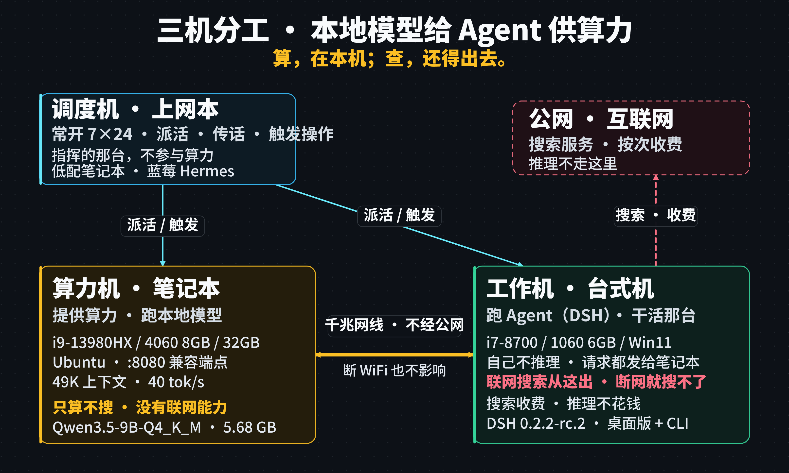

# 本地部署小模型，供 Agent 使用

> 一个 Agent 想省钱、想隐私不出门，最直接的办法是把模型搬到自己的机器上。
> 但"能跑起来"和"能当 Agent 用"是两件事。这份文档记录一条完整的路：怎么选运行时、怎么接客户端、怎么验证、以及踩过的坑。
>
> 实测时间 2026-11-12｜模型 Qwen3.5-9B-Q4_K_M｜单卡 RTX 4060 Laptop 8GB



---

## 目录

1. [先说结论](#一说结论)
2. [硬件与软件基线](#二硬件与软件基线)
3. [三条运行时路线，前两条是死路](#三三条运行时路线前两条是死路)
4. [部署步骤](#四部署步骤)
5. [接进客户端：改错地方会白忙一场](#五接进客户端改错地方会白忙一场)
6. [验证"真的跑本地"的三种硬办法](#六验证真的跑本地的三种硬办法)
7. [性能数据](#七性能数据)
8. [能力边界：十二轮实测](#八能力边界十二轮实测)
9. [客户端协议兼容性：这是最大的拦路虎](#九客户端协议兼容性这是最大的拦路虎)
10. [算力是本地的，联网不是](#十算力是本地的联网不是)
11. [踩坑汇总](#十一踩坑汇总)

---

## 一、先说结论

**1. 小模型最有价值的能力是「读」和「答」，不是「做」。**

- 读一份 19 KB 的真实文档，提炼出 11 个章节 + 3 条关键建议 → 准确
- 单步执行一条命令（`whoami`）→ 准确
- 但「查数 → 写文件 → 报结果」这种三步任务，三次尝试全部失败

**2. 瓶颈不在算力，在「步骤一多就散」。**

40 tok/s 的生成速度对 Agent 完全够用。真正让人等的是 4 秒的输入处理，不是输出。

**3. 能不能接上，取决于客户端的协议，不取决于模型。**

同样一个本地端点：

| 客户端 | 协议 | 能不能接 |
|---|---|---|
| DSH | `openai-completions`（标准 chat） | ✅ 能 |
| Codex | `responses` API（私有） | ❌ 不能 |

**这一条是整件事里最容易被忽略、代价最大的坑。**

---

## 二、硬件与软件基线

### 2.1 跑模型的机器（笔记本）

```
CPU      i9-13980HX
GPU      RTX 4060 Laptop，8 GB 显存
内存     32 GB
系统     Ubuntu 24.04
用途     承载模型服务，对外暴露 OpenAI 兼容端点
```

**为什么强调 8 GB 显存**：这是决定上下文上限的硬红线。模型本身占 5.68 GB，剩下 2.5 GB 给 KV cache。用满大约能做到 48K 上下文，再大就要挤爆显存、模型被踢回 CPU。

### 2.2 调用模型的机器（台式机）

```
CPU      i7-8700
GPU      GTX 1060 6 GB（本场景不参与推理）
系统     Windows 11
用途     跑客户端（DSH 桌面版 / headless CLI）
```

两台机器用一根网线直连，独立网段，不经过路由器 —— 这样断掉 WiFi 也能验证"到底是不是跑本地"。

### 2.3 模型

```
文件     Qwen3.5-9B-Q4_K_M.gguf
大小     5.68 GB
量化     Q4_K_M（4-bit，质量与体积的平衡点）
```

---

## 三、三条运行时路线，前两条是死路

### 3.1 Ollama：模板引擎太旧

```bash
ollama create qwen35-9b-32k -f Modelfile
# → Error: template error: template: :5: function "content" not defined
```

Ollama 0.17.5 的模板引擎不认 Qwen3.5 GGUF 自带 jinja 模板里用的 `content` 函数。模型没问题，运行时跟不上。

**不要去改模型模板迁就 Ollama** —— 模板改坏了，工具调用会一起废掉。

### 3.2 llama-cpp-python：不支持 `--jinja`

退而求其次用 pip 的 `llama-cpp-python` + `llama_cpp.server`。能跑、能对话，**但工具调用全废**：

```
传了 tools 参数，模型却回："我无法调用外部工具"
```

根因查证：

```python
from llama_cpp.server.settings import Settings
[k for k in Settings.model_fields.keys() if 'jinja' in k]
# → []      只有 chat_format / verbose，没有 jinja 选项
```

它只能套内置格式（chatml 等），用不了 GGUF 里的原生模板 —— 而模型的 `<tool_call>` 语法就定义在原生模板里。

**只要 Agent 需要工具调用，这条路直接否掉。**

### 3.3 llama.cpp 预编译包：一次成

关键只有一个参数：**`--jinja`**。

不要自己编译。官方 release 提供 CUDA 预编译包，选**和驱动匹配**的 CUDA 版本，解压即用。

---

## 四、部署步骤

### 4.1 取预编译包

```bash
# 两个包必须同版本，否则报 libcudart.so.13: not found
gh release download b12317 -R ggml-org/llama.cpp \
  -p 'llama-b12317-bin-ubuntu-cuda-13.5-x64.tar.gz'

gh release download b12317 -R ggml-org/llama.cpp \
  -p 'cudart-llama-b12317-bin-ubuntu-cuda-13.5-x64.tar.gz'
```

| 包 | 大小 | 内容 |
|---|---|---|
| `llama-*-bin-ubuntu-cuda-13.5-x64` | 177 MB | server 本体 + ggml-cuda 后端 |
| `cudart-*-bin-ubuntu-cuda-13.5-x64` | 424 MB | 配套 CUDA 运行时（cudart / cublas / cublasLt） |

```bash
mkdir -p ~/llama-cuda
tar -xzf llama-b12317-bin-ubuntu-cuda-13.5-x64.tar.gz -C ~/llama-cuda --strip-components=1
tar -xzf cudart-llama-b12317-bin-ubuntu-cuda-13.5-x64.tar.gz -C ~/llama-cuda
cd ~/llama-cuda && mv cudart-*/* . 2>/dev/null
```

**验证设备识别**：

```bash
LD_LIBRARY_PATH=~/llama-cuda ~/llama-cuda/llama-cli --list-devices
# Available devices:
#   CUDA0: NVIDIA GeForce RTX 4060 Laptop GPU (7805 MiB, 7689 MiB free)
```

如果输出 `(none)`，说明 CUDA 库没加载 —— 检查 `ldd libggml-cuda.so | grep 'not found'`。

### 4.2 启动脚本

`~/start-llama.sh`：

```bash
#!/bin/bash
export LD_LIBRARY_PATH=/home/<user>/llama-cuda:$LD_LIBRARY_PATH
cd /home/<user>/llama-cuda
exec ./llama-server \
  -m /home/<user>/models/Qwen3.5-9B-Q4_K_M.gguf \
  -ngl 99 \
  -c 49152 \
  -np 1 \
  --host 0.0.0.0 \
  --port 8080 \
  --jinja \
  --chat-template-kwargs '{"enable_thinking": false}' \
  -fa on
```

### 4.3 参数逐条说明

| 参数 | 作用 | 不加会怎样 |
|---|---|---|
| `-ngl 99` | 所有层放 GPU | 全跑 CPU，速度掉到个位数 tok/s |
| `-c 49152` | 上下文窗口 | 默认太小，DSH 一次请求就超 |
| `-np 1` | 单并发 slot | 多 slot 平分 KV cache，上下文缩水 |
| `--jinja` | 用 GGUF 原生模板 | **工具调用完全不可用** |
| `--chat-template-kwargs '{"enable_thinking":false}'` | 关思考模式 | 小 `max_tokens` 时全部被 think 吃掉，正文为空 |
| `-fa on` | Flash Attention | 不加显存吃紧；写 `-fa` 裸值会报参数错，必须显式 `on` |

### 4.4 上下文怎么定

```
模型本体             5.68 GB
KV cache（48K）     ~1.0 GB
总计                ~6.7 GB / 8.0 GB 可用
```

**48K 是 8 GB 卡的天花板附近。** 再往上（64K）显存会被挤爆，模型被踢回 CPU，速度灾难性下降。

**上下文不是越大越好**：DSH 单次请求固定开销就有 7,800 tokens（系统提示 + 工具定义 + 历史），49K 的窗口实际可聊约 40K。

### 4.5 验证端点

```bash
# 基础对话
curl -s http://127.0.0.1:8080/v1/chat/completions \
  -H 'Content-Type: application/json' \
  -d '{"messages":[{"role":"user","content":"用一句话说明三次握手"}],"max_tokens":80}'
```

**工具调用（关键验证，不通过就白搭）**：

```bash
curl -s http://127.0.0.1:8080/v1/chat/completions \
  -H 'Content-Type: application/json' -d '{
  "messages":[{"role":"user","content":"北京天气如何？用工具查"}],
  "tools":[{"type":"function","function":{
    "name":"get_weather",
    "parameters":{"type":"object","properties":{"city":{"type":"string"}}}}}]
}'
```

期望返回：

```json
{"tool_calls":[{"function":{"name":"get_weather","arguments":"{\"city\":\"北京\"}"}}]}
```

---

## 五、接进客户端：改错地方会白忙一场

以 DSH 0.2.2-rc.2 为例。

### 5.1 关键发现：`agent-default-model`

DSH 的模型路由由一个叫 **`agent-default-model`** 的插件负责，**不是 `agent-loop`**。

试过但**完全无效**的写法：

```yaml
# ❌ 这样写 config 能加载，但请求照旧发去云端
- id: agent-loop
  config:
    agents:
      - id: main
        provider: llama-cpp
        model: /path/to/model.gguf
```

`dsh --dump-config` 里能看到这段配置被完整加载，但实际请求依然发去 `api.deepseek.com`。

**正确写法**（用户补丁层 `~/.dsh/profiles/<profile>/cordis.patch.yml`）：

```yaml
# ① 注册 provider
- id: llm-pi-ai
  config:
    providers:
      llama-cpp:
        displayName: llama.cpp (local)
        apiKeyEnv: LLAMA_CPP_API_KEY
        api: openai-completions
        baseURL: http://<model-host>:8080/v1
        models:
          - id: /home/<user>/models/Qwen3.5-9B-Q4_K_M.gguf
            name: Qwen3.5-9B

# ② 指定默认模型 —— 真正生效的是这一段
- id: agent-default-model
  config:
    provider: llama-cpp
    model: /home/<user>/models/Qwen3.5-9B-Q4_K_M.gguf
```

**改完必须清掉旧会话再测** —— `dsh` 会沿用上次会话的模型绑定，旧会话里绑的还是云端。

### 5.2 桌面版 GUI 改不动

```
dsh --profile desktop --dump-config
# → error: profile "desktop" is managed exclusively by the Electron application
```

桌面版的 profile 被 Electron 独占，命令行改不了。它的模型选择在 GUI 设置里。

---

## 六、验证"真的跑本地"的三种硬办法

GUI 里显示「Qwen3.5-9B」**不算数** —— 界面显示和实际路由是两回事。三种办法，任选一种都能定性。

### 6.1 假 Key 测试（最干脆）

把云端的 key 换成无效值再跑：

```bash
DEEPSEEK_API_KEY=sk-INVALID-TEST-KEY-12345 dsh --profile headless "用一句话说明 DNS"
```

| 结果 | 含义 |
|---|---|
| 正常回答，不报错 | 没碰云端 |
| 报 401 / MISSING_CREDENTIAL | 还在偷偷调云端 |

**实测**：假 Key 下连问 6 个问题，全部正常回答，零报错。

### 6.2 断网测试

拔掉客户端的 WiFi（模型机与客户端之间有独立网线时），能答 = 本地。

**注意**：如果模型端点本身也走 WiFi，断网后答不出来并不能证明什么，只能说明它连不上。这条要先把链路搞清楚。

### 6.3 服务端日志对账

模型机上：

```bash
grep -E 'prompt eval time|n_gen =' /tmp/llama.log | tail
grep -c 'print_timing' /tmp/llama.log      # 累计请求数
```

客户端每问一句，这里就多一条 task。数字对得上，就是本地。

---

## 七、性能数据

### 7.1 三个核心指标

| 指标 | 全称 | 含义 | 用户体感 |
|---|---|---|---|
| **TTFT** | Time To First Token | 首字延迟 | 决定"卡不卡" |
| **TPS** | Tokens Per Second | 生成速度 | 决定"出字快不快" |
| **TPOT** | Time Per Output Token | 每 token 间隔 = 1/TPS | 同上 |

llama.cpp 日志里对应的字段：

```
prompt eval time   →  TTFT 的主体（输入处理耗时）
eval time          →  TPS（生成速度）
```

### 7.2 实测数值

| 场景 | TTFT | TPS | 上下文占用 |
|---|---|---|---|
| 短提示（15 tokens） | **67 ms** | 40 tok/s | — |
| 中等（750 tokens） | 660 ms | 40 tok/s | 41,003 |
| DSH 真实请求（7,786 tokens） | **4,082 ms** | 40 tok/s | 47,473 |
| 台式机流式实测 | 0.24 s | 41.4 tok/s | — |

**关键结论**：

- **TPS 恒定在 40 tok/s**，与输入长短无关
- **TTFT 全部来自输入处理**，输入越长等得越久
- 4 秒的首字延迟是"满上下文请求"的代价，不是模型慢

### 7.3 上下文预算

```
系统提示 + 工具定义 + 历史（空对话）  ≈ 7,800 tokens
单轮增长                             ≈ 300–800 tokens
DSH 单请求实测范围                   16,880 – 33,000 tokens
```

49,152 的窗口，扣掉固定开销，实际可聊约 40K。**长会话必须开新的，别硬续。**

---

## 八、能力边界：十二轮实测

全部用 `dsh --profile headless` 逐条测，**每条都验收产出物，不采信「已完成」的自述**。

### 8.1 能做好的

| 测试 | 结果 | 耗时 |
|---|---|---|
| 单步命令（`whoami`） | ✅ 正确执行，还解释了含义 | 12 s |
| 写脚本并运行 | ✅ 843 字节，逻辑正确，实跑输出对 | 25 s |
| 长文提炼（19 KB 真实文档） | ✅ 一句话定性准确，11 个章节全对，3 条建议准确 | 34 s |
| 长文提炼（49 KB README） | ✅ 6 条要点全部准确，无跑偏 | 25 s |
| 短公文（150 字通知） | ✅ 标题/正文/落款齐全，语气对 | 13 s |
| 多轮记忆（记住三个数字） | ✅ 第二问答对 | 14 s |

**这项最值得说**：19 KB 的真实工作文档（一个技能说明），它给出的三件事全部命中 —— 一句话定性写对了文档的用途，11 个章节一个不漏，三条建议都是原文里最核心的实操点。**长文提炼是它的强项，不是勉强。**

### 8.2 做不动的

**① 三步以上任务会摆烂**

要求「查 CPU 型号 → 查时间 → 写进文件」，三次尝试全部失败：

```
第一次：写了 67 字节套话（"这是由 XX 模型创建的测试文件"）
第二次：承认「您说得对」，然后反问「请问您希望我做什么？」
第三次：说「收到！请告诉我需要执行的具体步骤」
```

把动作拆成单步「执行 whoami」→ 立刻做对。

> **小模型不是笨，是步骤一多就散。任务必须拆成单步下派。**

**② 自述不可信，必须验收**

说「文件已创建成功」，实际 67 字节，三条规定内容一条没写。

**③ 环境常识弱**

- 问它跑在哪台机器上 → 答错了（把调用方当成模型主机）
- 读配置里的 Linux 路径在 Windows 上不成立 → 毫无异议
- 日期会算错：11 月 12 日问天气，它搜索「2026 年 10 月 20 日 天气」

**④ 不会主动查证**

问「你的 provider 是谁」→ 答非所问。改成「读这个配置文件，告诉我 provider」→ 才答对。

**⑤ 带具体数据的正式文档：退回模板**

150 字的短通知写得好，换成 300 字、要求「数据要具体」的情况汇报，输出变成：

```
## 关于 [项目名称] 的工作情况汇报
一、总体进展   目前已完成 [阶段目标]，关键节点 [时间节点] 已顺利达成
二、主要工作   共计 [人数] 人 / 完成 [具体成果] / 进度完成 [百分比]%
```

通篇方括号占位符，一个真实数据都没有，主题完全不体现。

> 模板越复杂，它越倾向于退回通用骨架。任务里的具体种（某个专业领域）被「公文格式」挤掉了。

**⑥ 长会话里的多重约束会漏**

同一会话连下四条约束：

```
第 1 轮：以后回答都用英文         → 回「OK」          ✅
第 2 轮：末尾加句号，2+2=？       → 「2+2 等于 4。」   ✅ 照做
第 3 轮：不说算式，只给结果       → 「2。」           ✅ 照做（但丢了英文）
第 4 轮：按三个约定，5+5          → 「10。」          ❌ 中文，没句号
```

> 前两轮守得住，第三轮开始丢，第四轮全丢。能记住「一件事」，记不住「一叠规矩」。

**⑦ 写文件会找错路径、抄错内容**

要求写一份会议纪要到指定文件：

- 第一次：耗时 160 秒，在目录里乱找，最后把另一个 67 字节的测试文件抄了过去
- 第二次：说「文件已创建，请提供您希望写入的具体内容」

换干净工作目录再试，仍然只创建空文件，然后反问内容。

**⑧ 长上下文里的旧内容会污染新任务**

39K 上下文里残留着之前的技术讨论，下达一个**完全不同的业务议题**的写作任务，它输出的却是「系统能力与多智能体协作模式」—— 拿旧内容套新题目。

> 它不区分「这是之前的对话」和「这是当前任务」。长会话一定开新的。

### 8.3 一句话总结能力

```
读文档提炼      ✅ 可靠（强项）
单步执行命令    ✅ 可靠
小脚本编写      ✅ 可靠
写文件          ❌ 不可靠（找错路径、抄错内容）
带约束的写作    ❌ 不可靠（编造、跑题、套模板）
长会话          ❌ 不可靠（旧内容污染新任务）
```

---

## 九、客户端协议兼容性：这是最大的拦路虎

**同样一个本地端点，DSH 能接，Codex 接不上。** 这不是模型的问题，是客户端协议的问题。

### 9.1 DSH：能接

```yaml
api: openai-completions      # 标准 chat/completions，兼容
```

只要端点提供 `/v1/chat/completions`，DSH 就能用。

### 9.2 Codex：接不上

实测三次，三次撞墙：

**尝试一：环境变量指向本地端点**

```bash
OPENAI_BASE_URL=http://<model-host>:8080/v1 codex exec "..."
# → 超时 200 秒，无响应
```

**尝试二：走官方 OSS 通道**

```bash
codex exec --oss --local-provider lmstudio -m qwen3.5-9b "..."
# → Error: OSS setup failed: LM Studio is not responding.
```

它只认 `lmstudio` 和 `ollama` 两种本地方案，不接受任意 OpenAI 兼容端点。

**尝试三：自定义 provider 配置**

```bash
codex exec -c 'model_providers.local.base_url="http://<model-host>:8080/v1"' \
           -c 'model_providers.local.wire_api="chat"' ...
# → Error: `wire_api = "chat"` is no longer supported.
#   How to fix: set `wire_api = "responses"`
```

### 9.3 根因

```
客户端       协议                        状态
------------------------------------------------------
DSH          openai-completions（标准）    ✅ 兼容
Codex        responses（私有）             ❌ 不兼容
llama-server openai-completions（标准）     ← 只提供这个
```

**Codex 新版只支持 Responses API，不接受标准的 chat/completions。** 而 llama.cpp 只提供 chat/completions。

**两个协议对不上，跟模型能力没关系。**

### 9.4 结论

> **本地模型能不能用，第一道关不是显存、不是模型质量，而是「客户端支不支持标准协议」。**

Codex 这类工具把整条调用链（工具定义、流式事件、思考块、沙箱审批）都绑在自己的协议上，私自替换端点根本走不通。这也解释了为什么它虽然有「本地模型」选项，却只能连 LM Studio / Ollama 那两个特定实现。

**选型时的顺序应该是**：

```
1. 客户端支不支持 openai-completions？
2. 不支持 → 这条路走不通，换客户端或用官方支持的本地方案
3. 支持 → 再考虑显存、上下文、模型质量
```

---

## 十、算力是本地的，联网不是

一个很容易被混淆的点：**把模型搬到本地，不等于让整个 Agent 变成离线的。**

这两件事在物理上就是两条 链路，必须分开看。

### 10.1 三台机器的分工

```
机器 A  常开的一台，跑调度用的 agent，负责触发各种操作
机器 B  提供算力，跑 llama-server，只暴露一个 OpenAI 兼容端点
机器 C  跑客户端（DSH），通过网线访问机器 B 的端点
```

**用 agent 去驱动 agent、去触发别的机器上的操作，本身没有隐患** —— 这正是这套架构存在的意义，不是需要防的东西。

### 10.2 断网实测：哪条断了，哪条没断

在客户端机器（C）上断开 WiFi、只保留到机器 B 的网线，然后下达一个需要联网查询的任务：

| 环节 | 状态 | 说明 |
|---|---|---|
| 模型推理 | ✅ 正常 | 走网线到机器 B，与公网无关 |
| 联网搜索 | ❌ 失败 | 断网后搜索工具够不着外网 |

客户端界面上能看到它**去调用了搜索功能**，然后因为没外网而失败。恢复 WiFi 后，同一个任务立刻搜索成功。

**结论一句话**：

> 断网只影响搜索，不影响推理。模型在本机算，搜索还得出去拿。

### 10.3 为什么不能把搜索也搬进来

提供算力的机器（B）只跑 `llama-server`，**没有配任何联网能力或插件** —— 它只会算，不会搜。

那客户端的搜索能不能自己配？

**不能。这个版本的客户端填不了外部搜索 API。**

- Tavily / Google / 百度 这些第三方搜索服务的 key，**现在填不进去**
- 它只能用客户端自身（DeepSeek）的搜索服务
- 那个服务是**收费**的

### 10.4 账算得很清楚

既然是两条链路，费用也就分得开：

| 项目 | 花不花钱 |
|---|---|
| 模型推理 | **不花**（本地显卡算） |
| 联网搜索 | 花（走服务商的搜索接口） |

**实测**：一整天反复对话、多轮测试下来，云端 API 的账单**加起来不到 0.1 元**，基本就是搜索那几次调用产生的。

**这正好反证了推理确实在本地跑** —— 如果模型走了云端，这点钱根本打不住。

### 10.5 一个提醒

机器 B 那台提供算力的机器，**它的 WiFi 不能断**。

不是因为模型需要联网，而是因为**客户端要连到它**。链路是「C → 网线 → B」，B 掉线，C 就够不着模型了。这一层和公网无关，但和网络可达性有关，两个概念别混。

---

## 十一、踩坑汇总

| 现象 | 根因 | 修法 |
|---|---|---|
| `function "content" not defined` | Ollama 模板引擎太旧 | 换 llama.cpp |
| 工具调用不生效，模型答「无法调用工具」 | llama-cpp-python 不支持 `--jinja` | 换 llama.cpp 原生 server |
| `libcudart.so.13: not found` | 预编译包与 CUDA 运行时版本不匹配 | 两个包取同一版本 |
| 服务起来了但 GPU 只占 15 MiB | CUDA 库没加载，全跑 CPU | `LD_LIBRARY_PATH` 指到库目录 |
| `--list-devices` 返回 `(none)` | 同上 | 先修库路径 |
| `invalid argument: --no-mmap` | 该版本无此参数 | 删掉 |
| `-fa` 报「expected value」 | 新版要显式 `on/off/auto` | 写 `-fa on` |
| 回复 content 为空 | token 全被 thinking 吃掉 | `--chat-template-kwargs '{"enable_thinking":false}'` |
| `exceed_context_size_error`，n_ctx=16384 | 实际调的是云端，不是本地 | 改 `agent-default-model` |
| 改了 `agent-loop` 不生效 | 路由由 `agent-default-model` 管 | 改对插件 |
| apt 装 CUDA toolkit 卡死 | 镜像源拉 189 MB 包无进展 | 放弃编译，用预编译包 |
| 一份 6 MB 的 docx 读进去卡死 | 整份文件被塞进上下文 | 大文件先切分，不要整份喂 |
| Codex 接不上本地端点 | 只支持 Responses API | 换客户端 |

---

## 十一、怎么用才对

**适合**：

- 读长文档、提炼要点、整理结构
- 短问答、翻译、改文字、解释概念
- 单文件小脚本
- 短公文（通知、告示这类格式固定的）

**不适合**：

- 多步复杂任务（必须拆成单步下派）
- 需要准确事实的回答（会编）
- 带具体数据的正式汇报（会套模板）
- 长会话（旧内容污染新任务）

**用法建议**：

```
① 任务拆成单步，一步一句，别一次说完
② 每步都验收产出物，不采信「已完成」
③ 长会话开新的，别硬续
④ 写文件的活自己干，别交给小模型
```

**最关键的一句**：

> 小模型的瓶颈不在算力，在「步骤一多就散」。
> 所以要靠外部盯着步骤，不能指望模型自己记住走到第几步。

这也正是「显性编排」的价值 —— 步骤、状态、验收都得摆在台面上。

---

## 附：环境信息

```
模型机    i9-13980HX / RTX 4060 Laptop 8GB / 32GB RAM / Ubuntu 24.04
客户端    i7-8700 / GTX 1060 6GB / Windows 11
模型      Qwen3.5-9B-Q4_K_M.gguf（5.68 GB）
运行时    llama.cpp b12317（CUDA 13.5 预编译包）
上下文    49,152
显存      ~6,760 / 8,188 MiB
生成速度  40 tok/s
首字延迟  0.07 s（短）/ 4.1 s（满上下文）
客户端    DSH 0.2.2-rc.2（桌面版 + headless CLI）
```
