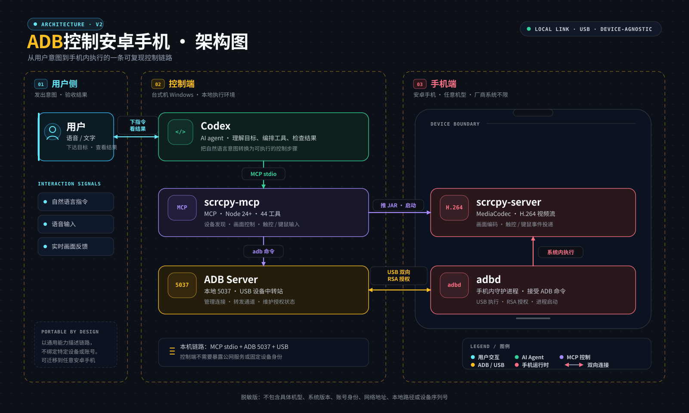

# 安卓 ADB / scrcpy 控制

本文件是 `SKILL.md` 的完整中文副本；Codex 自动识别的默认入口仍然是 `SKILL.md`。

从台式机连接并验证一台真实安卓手机。优先使用 ADB、scrcpy 和结构化 UI 信息，不要盲目点击坐标；执行操作前先识别设备自身的参数和应用结构。

## 延伸阅读

- [手机智能体（phone use agent）：11款能操作真实手机的开源工具](https://personalagentbench.com/zh-cn/phone-use/) —— 绒毛（Muse）梳理该主题时引用的 Zentor 源码横评，覆盖 iPhone、安卓、无障碍、ADB、云端手机、确认机制、遥测与许可差异。页面注明中文版由英文版机器翻译，如有出入以 [英文规范页](https://personalagentbench.com/phone-use/) 为准。

## 架构图



链路分三段：**用户侧**（语音/文字下达目标、看画面反馈）→ **控制端**（台式机 Windows 上的
Codex，经 MCP stdio 调 scrcpy-mcp，再经 adb 命令连本地 ADB Server）→ **手机端**（USB + RSA 授权，
adbd 接收命令，scrcpy-server 用 MediaCodec 编码 H.264 回传）。

图按通用能力描述，不绑定具体机型、厂商系统版本、账号或网络地址，可直接迁移到任意安卓手机。
字号按「缩到手机宽度 750px 仍可读」设计，可直接分享或截图使用。
源文件：[`assets/adb-architecture-zh.svg`](assets/adb-architecture-zh.svg)

## 操作边界

- 不绕过安全锁屏、密码、PIN、图案或生物识别。可以发送唤醒命令，但需要用户本人解锁。
- 短信、电话、消息、上传、支付、删除、安装和安全设置都属于外部操作。遵循用户的明确指令，核对准确对象和内容；对象或内容有歧义时先停止。
- 不能只凭界面上显示为“卡 1/卡 2”就判断运营商。应把运营商名称、电话账户和订阅 ID 对应起来，并在拨号界面或通话记录中再次验证。
- 除非用户需要核对操作，否则不要在输出中暴露联系人号码、短信内容、通话记录等个人信息。
- 屏幕变化后不得复用之前的坐标或元素索引。每次点击前重新抓取当前 UI。

## 1. 识别安卓设备与型号

连接设备后先识别型号和系统信息。运行随技能附带的只读脚本：

```powershell
pwsh -NoProfile -File scripts/android-info.ps1
```

多设备环境按序列号选择：

```powershell
pwsh -NoProfile -File scripts/android-info.ps1 -Serial "<序列号>"
```

脚本会输出序列号、厂商、原始型号属性、品牌、设备代号、Android 版本、SDK、屏幕尺寸、屏幕密度和 SIM 订阅信息。也可以直接执行：

```powershell
adb devices -l
adb -s <序列号> shell getprop ro.product.manufacturer
adb -s <序列号> shell getprop ro.product.model
adb -s <序列号> shell getprop ro.build.version.release
adb -s <序列号> shell getprop ro.build.version.sdk
adb -s <序列号> shell wm size
adb -s <序列号> shell wm density
```

`ro.product.model` 可能是厂商内部代号，不一定等于市场名称。需要友好名称时，再与“设置 → 关于手机”中的展示名称核对。可复用技能中不要写死某一台手机的具体型号。

## 2. 安装绒毛（Muse）三件套

“绒毛（Muse）”是这套精简安装方案的称呼，不是需要单独安装的软件包。三件套是 scrcpy/ADB、Node.js 24+ 和 scrcpy-mcp。

Windows 上，scrcpy 的 WinGet 包已经包含 `adb.exe`：

```powershell
winget install --exact Genymobile.scrcpy
```

从 Node.js 官方 LTS 页面安装 Node.js 24 或更新版本：<https://nodejs.org/>。当前 `scrcpy-mcp` 要求 Node 24+。安装后重新打开终端，使 PATH 生效。

连接并授权手机后，执行绒毛方案的三行验收：

```powershell
adb devices
scrcpy --version
scrcpy
```

`adb devices` 应显示一台状态为 `device` 的设备；`scrcpy --version` 检查客户端；`scrcpy` 会打开投屏窗口并持续运行，关闭窗口后进程结束。如果手机还没连接，先完成第 3 节。

再检查 MCP 运行环境：

```powershell
node --version
npx --version
```

如果命令找不到，先用 `Get-Command` 查询绝对路径，或检查 WinGet 包目录。不要仅因为当前终端 PATH 过期就重复安装一套工具。

## 3. 打开 USB 调试并授权电脑

1. 在手机上启用开发者选项。
2. 打开 USB 调试。
3. 使用能传输数据的 USB 线连接电脑。
4. 解锁手机并同意 RSA 授权弹窗。
5. 有“始终允许这台计算机”时勾选。

验证：

```powershell
adb devices -l
```

正常状态应为 `device`：

- `unauthorized`：等待用户在手机上点击允许。
- `offline`：重新插拔 USB，或重启 ADB 服务。
- 没有设备：检查数据线、USB 模式（优先文件传输）、接口和驱动。

恢复命令：

```powershell
adb kill-server
adb start-server
adb devices -l
```

不要尝试自动点击 USB 授权弹窗，也不要尝试绕过安全解锁。

## 4. 验证投屏和屏幕状态

启动可见的 scrcpy 窗口：

```powershell
scrcpy -s <序列号>
```

检查窗口：

```powershell
Get-Process scrcpy | Select-Object Id, MainWindowTitle, Responding
```

操作界面前检查屏幕是否唤醒：

```powershell
adb -s <序列号> shell dumpsys power | Select-String "mWakefulness="
```

如果状态是 `Dozing`，发送唤醒键：

```powershell
adb -s <序列号> shell input keyevent KEYCODE_WAKEUP
```

随后截图检查锁屏状态。如果出现密码、PIN、图案或生物识别界面，停止并请用户解锁。

截图并取回：

```powershell
adb -s <序列号> shell screencap -p /sdcard/codex-screen.png
adb -s <序列号> pull /sdcard/codex-screen.png .\codex-screen.png
```

## 5. 注册 scrcpy-mcp

如需先用绒毛给的一行命令做独立检查：

```powershell
npx -y scrcpy-mcp
```

它会启动本地 MCP stdio 服务并等待 MCP 客户端连接，不会打开可见的 scrcpy 窗口；按 `Ctrl+C` 停止。要在 Codex 中持久使用，则继续执行下面的注册配置。

找到同时包含 `scrcpy.exe` 和 `scrcpy-server` 的安装目录，然后注册 stdio MCP：

```powershell
$adb = (Get-Command adb).Source
$scrcpy = (Get-Command scrcpy).Source
$scrcpyDir = Split-Path $scrcpy
$server = Join-Path $scrcpyDir "scrcpy-server"

codex mcp add android `
  --env "ADB_PATH=$adb" `
  --env "SCRCPY_SERVER_PATH=$server" `
  -- npx -y scrcpy-mcp
```

验证配置：

```powershell
codex mcp get android
codex mcp list
```

该 MCP 在本地通过 stdio 运行。启用前应确认软件包和来源可信，因为它会暴露设备控制、Shell 和文件传输能力。

如果当前 Codex 任务是在注册 MCP 之前启动的，可能不能动态出现新工具。重启 Codex 或新建任务后再试。

## 6. MCP 冒烟测试

先执行无害测试，再碰敏感应用：

1. `device_list`
2. `start_session`
3. `screenshot`
4. `app_current`
5. 用 `app_start` 打开计算器等安全应用
6. 用 `ui_find_element` 查找一个已知按钮
7. 使用刚返回的坐标执行 `tap`
8. 再截图确认界面变化
9. 不再需要快速会话时执行 `stop_session`

只有一台设备时，MCP 通常会自动选择。多设备时传入 `serial`，或设置 `ANDROID_SERIAL`。

## 7. 可靠的界面操作

操作前先抓取当前 UI：

```powershell
adb -s <序列号> shell uiautomator dump /sdcard/window.xml
adb -s <序列号> pull /sdcard/window.xml .\window.xml
```

根据可见文字、内容描述或资源 ID 定位控件，并从当前元素的 `bounds` 计算点击坐标。

每次操作采用以下循环：

1. 抓取并检查当前界面。
2. 只执行一个动作。
3. 再次抓取 UI 或截图。
4. 确认发生了预期变化再继续。

不同厂商和系统版本的资源 ID、坐标、标签布局和应用包名都可能不同。必须现场识别，不能把另一台手机上的结构直接照搬。

## 8. 识别双卡与运营商

从订阅信息中确认 SIM 映射：

```powershell
adb -s <序列号> shell dumpsys isub |
  Select-String "Logical SIM slot|SubscriptionInfoInternal"

adb -s <序列号> shell dumpsys telecom |
  Select-String "PhoneAccount|defaultVoiceSubId"
```

重点建立以下字段之间的映射：

- `id=<subId>`
- `simSlotIndex=<卡槽索引>`
- `displayName=<显示名称>`
- `carrierName=<运营商>`

在某些 Android 版本中，Telecom 电话账户 ID 与订阅 ID 相同，但必须验证，不能默认假设。

拨号时最稳妥的方法是：

1. 用号码预填拨号界面。
2. 重新抓取 UI，读取两个带运营商名称的拨号按钮。
3. 点击与用户指定运营商匹配的按钮。
4. 在通话界面或通话记录中确认实际使用的订阅。

预填号码：

```powershell
adb -s <序列号> shell "am start -a android.intent.action.DIAL -d tel:<号码>"
```

核对最近通话：

```powershell
adb -s <序列号> shell "content query --uri content://call_log/calls --projection _id:number:name:type:date:duration:subscription_id:phone_account_address --sort 'date DESC' | head -n 5"
```

通话时长为 0 秒、或者当前没有活动通话时，应报告为“未接通”，不能描述为已通话。

## 9. 联系人与短信

联系人数据库可读时，按完整姓名精确查询。PowerShell 中必须保留 SQL 字符串的单引号，否则姓名会被当成列名：

```powershell
adb -s <序列号> shell "content query --uri content://com.android.contacts/data --projection display_name:data1:mimetype --where `"display_name='<姓名>'`""
```

如果查询被权限拒绝或出现多个同名联系人，改用联系人界面核对；仍有歧义时停止。

只准备短信草稿：

```powershell
adb -s <序列号> shell "am start -a android.intent.action.SENDTO -d sms:<号码> --es sms_body '<短信内容>'"
```

发送前核对收件人和完整文本。只有在用户已授权该收件人和该内容时，才点击发送按钮。发送后检查“发送中”“已发送”或“已送达”等状态；是否送达取决于运营商和网络。

## 10. 闹钟与计时器

先识别时钟应用包名，不要写死某个厂商的包名：

```powershell
adb -s <序列号> shell pm list packages |
  Select-String "alarm|clock|deskclock"
```

打开对应应用，抓取当前 UI，识别每个闹钟卡片和开关。只修改用户指定的闹钟，并在操作后重新读取开关状态。

核对系统级计划：

```powershell
adb -s <序列号> shell dumpsys alarm |
  Select-String "Alarm clock:|triggerTime="
```

时钟界面可能只显示最近的待触发闹钟，即使后面还有其他已启用闹钟。因此每个请求启用的闹钟开关都要单独验证，再报告完成。

## 常见故障

- `unauthorized`：请用户在手机上允许 USB 调试；重新插拔后可能需要再次授权。
- 锁屏后设备仍在但无法操作：ADB 连接存在，但安全锁屏会阻止界面控制。
- 找不到 `scrcpy`：重新打开终端，或直接使用可执行文件绝对路径。
- MCP 服务启动但当前任务没有工具：重启 Codex 或新建任务。
- scrcpy 服务端版本不匹配：让 `SCRCPY_SERVER_PATH` 指向同一套 scrcpy 安装中的 `scrcpy-server` 文件。
- 有多个设备：ADB/scrcpy 使用 `-s <序列号>`，MCP 工具传入 `serial`。
- 屏幕休眠或锁定时 UI dump 失败：先唤醒并请用户手动解锁，然后重试。
- 应用很快返回桌面：根据当前 UI 和通话/应用记录区分“未接通、被拒接、启动失败”和“操作成功”。
