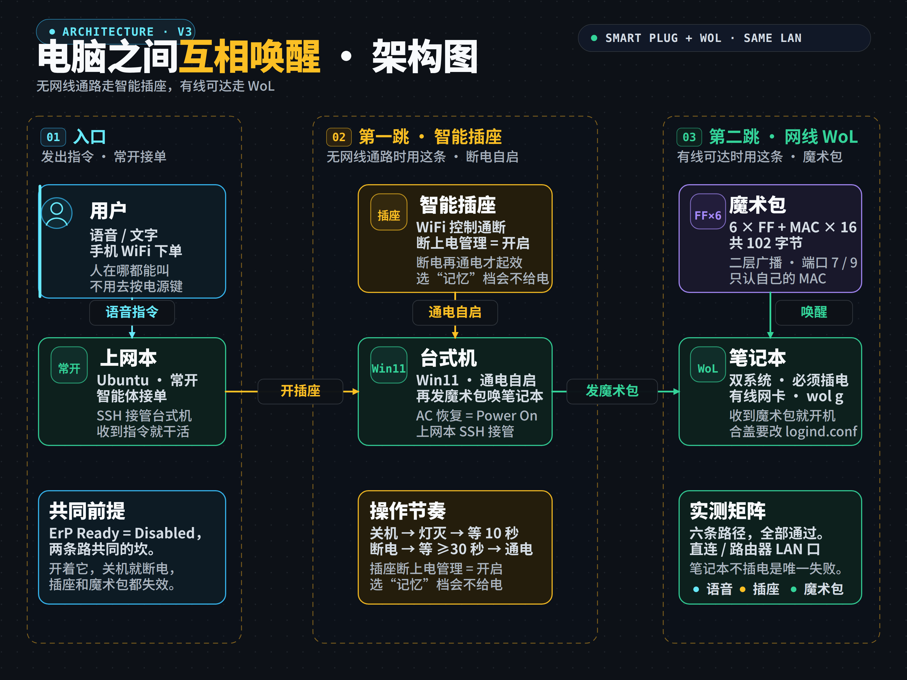

# 远程唤醒电脑：智能插座 + WoL

两条路接力，把一台关着的机器叫起来：**没有网线通路就走智能插座**，**有线可达就发魔术包**。两者前提相同——`ErP Ready = Disabled`。

---

三台机：**上网本**（Ubuntu，常开）、**台式机**（Win11）、**笔记本**（Ubuntu + Win11 双系统）。



## 现在实际在跑的闭环

先讲清楚每天真正在用的那条链——不是实验，是日常：

```
① 人在手机上说话（WiFi）
        ↓
② 上网本（常开）收到，智能体接单
        ↓
③ 上网本开智能插座 → 台式机通电自启
        ↓（台式机和上网本隔一堵墙，网线拉不过去，WoL 用不上）
④ 上网本的智能体经 SSH 接过台式机
        ↓
⑤ 台式机 —— 如果那根网线插着 —— 再发魔术包唤醒笔记本
```

**第一跳为什么是插座**：上网本到台式机没有网线通路（WiFi 无法唤醒，见后文），只能靠插座断电恢复自启。

**第二跳才是 WoL**：台式机到笔记本有网线，魔术包可达。

插座负责没有网线的那一段，WoL 负责有线可达的那一段。

## 两条路的分工

| | 智能插座 + 断电自启 | 网线 WoL |
|---|---|---|
| 触发方式 | 插座通电 | 魔术包 |
| 前提 | BIOS `Restore AC Power Loss = Power On` + `ErP Ready = Disabled` | `ErP Ready = Disabled` |
| 覆盖范围 | **只能叫醒接了插座的那一台** | 同广播域内任意有线机器 |
| 需要网线吗 | 不需要 | 需要（直连或同交换机） |
| 是否依赖网线 | ✅ 不依赖，机器之间无需连线 | ❌ 必须有线且同广播域 |
| 成本 | 几十块一个 | 零（用现有的线） |

**⇒ 两条路的前提里都有 `ErP Ready = Disabled`，这是共同的坎。**

## 一、智能插座：无网线通路时用这条

**适用**：两台机器之间没有网线通路（WiFi 无法唤醒）；或目标机主板不支持 WoL。

**BIOS（台式机，华硕主板在 `Advanced → APM Configuration`）**

| 项目 | 设为 | 为什么 |
|---|---|---|
| **Restore AC Power Loss** | **Power On** | 断电再来电就自动开机，插座方案的核心 |
| **ErP Ready** | **Disabled** | 开着会把待电一起掐掉，插座也失效 |
| Power On By PCI-E | 按需 | 这是「被别人 WoL 唤醒」用的，插座方案不需要 |

⚠️ **`Power On By PCI-E` 与插座方案无关**：它是让台式机自己能被人用魔术包叫醒；插座方案是「断电恢复」，走的是另一条路。两个可以并存，不冲突。

**Windows 侧：必须关快速启动**

```powershell
$k = "HKLM:\SYSTEM\CurrentControlSet\Control\Session Manager\Power"
Set-ItemProperty -Path $k -Name HiberbootEnabled -Value 0 -Type DWord
(Get-ItemProperty -Path $k -Name HiberbootEnabled).HiberbootEnabled   # 必须回读 0
```

**快速启动开着时，「关机」其实是休眠**（把内核会话写进休眠文件），主板仍处于软关机而非 G3 —— 插座断电再上电，BIOS 的恢复逻辑根本不会触发。

**操作节奏（顺序错了就开不了机）**

```
关机（shutdown /s，不是睡眠）
  ↓ 等电源灯完全熄灭
  ↓ 再等约 10 秒（主板进入 G3）
插座断电
  ↓ 等 ≥30 秒（华硕文档：断电恢复只在 G3 稳定后生效）
插座通电
  ↓ 机器自己起来
```

**插座自身的设置**：App 里「断上电管理」必须选【开启】（有的叫「常开/通电即开」）。

| 选项 | 行为 | 能不能用 |
|---|---|---|
| **开启** | 每次通电都输出 | ✅ 只能选这个 |
| 记忆 | 延续断电前状态 | ❌ 实测出现过不给电 |
| 关闭 | 每次通电都不输出 | ❌ 主板收不到 AC 恢复 |

**踩过的坑**

| 现象 | 原因 | 处理 |
|---|---|---|
| 插座灯亮、App 在线，机器纹丝不动 | 输出口没电（选了「记忆」档） | 先看插座灯/输出，再进 BIOS |
| 断电太急，下次不启动 | 关机瞬间硬切，系统被判「异常断电」 | 等电源灯全灭 + 10 秒再断 |
| 来电后机器不自动起 | 快速启动没关 / 断电时间不够 / BIOS 没保存 | 按顺序排查，别先怀疑插座 |

**判「异常断电」的办法**（目标机事件日志）：

```powershell
Get-WinEvent -FilterHashtable @{LogName='System'; ID=41,1074,6008} -MaxEvents 6 |
  Select-Object TimeCreated,Id
```

`1074` = 正常关机 ✅ ｜ `41` = 未正常关机情况下断电 ❌

**插座是应急开关，不是日常开关**：一直通电时再点一次「开」什么都不会发生——BIOS 监听的是「掉电后重新上电」这一跳变，不是电平。平时直接按机箱电源键开关机，要远程开机才断电。

## 二、网线 WoL：有线可达时用这条

### 结论先说

```
唯一前提   接收方 BIOS 里 ErP Ready = Disabled
次要条件   笔记本必须插着电源（电池供电时网卡会断电）
发送方     谁在线谁发，用什么设备都行
网络       同一广播域即可——直连、过 Hub、过交换机都通
```

### 实测矩阵（2026-11-11，六条路径全通）

| 发送方 | 接收方 | 连接方式 | 结果 |
|---|---|---|---|
| 笔记本 | 台式机 | 网线直连 | ✅ |
| 上网本（USB 转网口） | 台式机 | 网线直连 | ✅ |
| 上网本（USB 转网口） | 台式机 | 经路由器 LAN 口 | ✅ |
| 台式机 | 笔记本 | 网线直连 | ✅ |
| 上网本（USB 转网口） | 笔记本 | 网线直连 | ✅ |
| 上网本（USB 转网口） | 笔记本 | 经路由器 LAN 口 | ✅ |

失败的只有一种：**笔记本自己不插电源**——网卡跟着断电，怎么发都收不到。

### 配置三步

**① 接收方 BIOS：关掉 ErP**

进 BIOS（华硕：关机状态按住 F2 再按电源键，F7 进高级模式）：

| 项目 | 设为 | 说明 |
|---|---|---|
| **ErP Ready** | **Disabled** | 唯一必要条件。开着它，关机后网卡彻底断电 |
| Network Stack | 可开可关 | 只管 PXE 网络引导，实测与 WoL 无关 |
| IPv4 / IPv6 PXE | 建议关 | 关掉开机就不会卡在网络引导上 |
| Power On By PCI-E | Enabled | 台式机主板上的项，笔记本一般没有 |

**② 接收方系统：把网卡设成监听魔术包**

Linux：

```bash
sudo ethtool -s eno2 wol g
sudo ethtool eno2 | grep Wake-on     # 应显示 Wake-on: g
```

持久化（NetworkManager，否则重启就丢）：

```bash
nmcli connection show                 # 找到有线连接名
sudo nmcli connection modify "<连接名>" ethernet.wake-on-lan magic
```

Windows：

```
关快速启动    电源选项 → 选择电源按钮的功能 → 更改当前不可用的设置 → 取消"启用快速启动"
允许唤醒      设备管理器 → 网卡 → 属性 → 电源管理 → 勾"允许此设备唤醒计算机"
驱动开关      同一窗口"高级" → Wake on Magic Packet = Enabled
```

> 快速启动开着时，「关机」其实是休眠，WoL 会失效。这一项必须先关。

**③ 发送方：发魔术包**

```bash
# 有的发行版带这个命令
wakeonlan <目标机 MAC>

# 没有就用 Python，绑到指定网卡
python3 -c "
import socket, struct
MAC = bytes.fromhex('<目标机 MAC，去掉冒号>')
PKT = b'\xff'*6 + MAC*16
s = socket.socket(socket.AF_INET, socket.SOCK_DGRAM)
s.setsockopt(socket.SOL_SOCKET, socket.SO_BROADCAST, 1)
s.setsockopt(socket.IPPROTO_IP, 8, 1)          # IP_PKTINFO
idx = socket.if_nametoindex('eno2')
cmsg = [(socket.IPPROTO_IP, 8, struct.pack('i4s4s', idx, b'\x00'*4, b'\x00'*4))]
for _ in range(10):
    for port in (9, 7):
        s.sendmsg([PKT], cmsg, 0, ('192.168.0.255', port))
print('sent')
"
```

### 怎么判断"到底有没有待电"

不用翻日志，看两个信号就够：

```
网口灯亮 + 链路 10Mb/s      → 网卡在低功耗待电，可以唤醒
网口灯亮 + 链路 1000Mb/s    → 全速待电（有些网卡省电策略不同），也可以
灯灭 / 链路 Disconnected    → 断电了，发什么都没用
```

实测中，**向待电网卡发一个包，链路会立刻从 10M 跳回 1G**——这就是"网卡醒了"的信号，比等 ping 通快得多。

### 原理：为什么关机还能收包

正常关机是 **S5 软关机**：CPU、内存、硬盘都停了，但主板仍给网卡留一路 +3.3V 待机电，网卡以最低功耗持续监听网线。

唤醒靠**魔术包**（Magic Packet），结构固定：

```
FF FF FF FF FF FF          ← 6 字节同步流
+ 目标 MAC × 16 次          ← 连重复 16 遍
共 102 字节
```

网卡在待电监听中一旦认出这个模式，就向主板发一个 **PME**（电源管理事件）信号，主板随即加电开机。

**全程不需要操作系统参与**——系统还没起来，网卡自己就能认包、触发开机。这就是为什么"改 Windows 设置"对 Linux 机器毫无意义，也是为什么"换哪个系统启动"不影响能否被唤醒。

### 为什么必须同一广播域

WoL 工作在**第二层**，不用 IP。关机的机器没有 IP，路由器也认不出它，所以魔术包走**二层广播**：

```
以太网帧发到 FF:FF:FF:FF:FF:FF
或 UDP 发到 255.255.255.255 / 子网广播地址（如 192.168.0.255），端口 7 或 9
```

同一广播域内所有网卡都收到，但只有 MAC 跟包里重复 16 次那个一致的才响应——广撒网、精匹配。

**所以：**

| 场景 | 能否唤醒 |
|---|---|
| 直连、过 Hub、过交换机（同一 VLAN） | ✅ |
| 跨 VLAN、跨网段、跨路由器 | ❌ 广播过不去 |
| 无线发（WoWLAN） | ❌ 消费级基本不可用 |

想跨网段唤醒，得配定向广播、或先 VPN 回目标局域网、或在目标局域网里放一台常开中继转发。

### 为什么是 ErP（欧盟能源法规）

ErP 是欧盟《能源相关产品指令》（Energy-related Products Directive），现行版本 **(EU) 2023/826**，2025-05-09 起强制实施。它给设备的关机、待机、网络待机功耗划了上限：

| 模式 | 2025-05-09 起 | 2027-05-09 起 |
|---|---|---|
| 关机模式 | 0.50 W | 0.30 W |
| 待机（无状态显示） | 0.50 W | 0.50 W |
| 待机（有状态显示） | 0.80 W | 0.80 W |
| 网络待机（无 HiNA） | 2.00 W | 2.00 W |
| 网络待机（有 HiNA） | 8.00 W | 7.00 W |

BIOS 里开 ErP，就是切断 USB、PCIe 插槽、网卡等外设的待机供电，把关机功耗压到 0.5W 以下。

**代价：** 网卡彻底没电，听不到魔术包，远程唤醒全部失效。

**关掉 ErP：** 主板持续给网卡供待机电压，关机功耗升到 1.5W 上下。

> **这不是故障，是取舍**：要远程唤醒，就得接受多耗这点电；想极致省电，就放弃远程唤醒。

## 踩过的坑

| 现象 | 原因 | 处理 |
|---|---|---|
| 关机后网口灯灭，怎么发都不行 | ErP 开着 | 进 BIOS 关掉 |
| 笔记本拔了电源就唤不醒 | 电池供电时厂家切断网卡待电 | 插着电用 |
| 网卡设了 `wol g`，重启又变回 `d` | 没持久化 | nmcli 里配 `wake-on-lan magic` |
| Windows「关机」后叫不醒 | 快速启动开启，「关机」其实是休眠 | 关掉 `HiberbootEnabled` |
| 魔术包发出去了，机器不醒 | 发送走了默认路由（比如 WiFi），没从目标网段的网卡出去 | 绑接口发送（`IP_PKTINFO` / `SO_BINDTODEVICE`） |
| 合上盖子唤醒后，屏幕亮一下又灭 | 系统检测到合盖，进了睡眠 | 要长期合盖运行，改 `logind.conf` 的 `HandleLidSwitch` |
| 开机后卡在 PXE 网络引导 | 网络启动被设成第一启动项 | BIOS 里调回硬盘优先 |

---

## 开工前的三句问话

动手前先问清楚，能省掉一整轮试错：

```
① 目标和发送方之间，有没有网线通路？
   有   → 走 WoL
   没有 → 只能插座（WiFi 唤不醒）

② 目标机是笔记本还是台式机？
   笔记本 → 额外要求：必须插电源（电池供电时网卡会断电）
   台式机 → 接墙电，没这个限制

③ 目标机 BIOS 里 ErP Ready 是什么状态？
   不确定 → 先关机，看对端网口灯/链路速率再判断
```

## 三句话分清现场

```
对端网口灯灭 / 链路 Disconnected      网卡没电，发什么都没用 → 查 ErP
对端网口灯亮 / 链路 10 Mb/s           低功耗待电，正常监听 → 可以发包
对端网口灯亮 / 链路 1 Gbps            全速待电（部分网卡如此）→ 也可以发包
```

**关键：判断对端状态只能看对端那一侧**（或看对端网口灯），看发送方自己的 `ethtool` 速度没意义——那可能只是这端自己的协商值。

## 这个方案的边界

- **只能唤醒有线连接的机器**。WiFi 唤醒（WoWLAN）需要网卡硬件 + 驱动 + 路由器保持关联三层配合，消费级笔记本基本不实现，不要当方案。
- **只能在同一广播域内唤醒**。跨 VLAN、跨网段、跨互联网都到不了，除非配定向广播或在目标局域网放一台常驻中继。
- **USB 转网口可以当发送方，不能当接收方**。发送只需要能发包；接收需要关机时那一路还有待电，USB 口在 S5 下通常不给电。
- **插座方案只能管一台机**。要唤醒多台，每台各配一个插座；WoL 则一个广播域内通吃。

## 常被问到的几件事

**Q：为什么不能直接用 WiFi 发魔术包？**
关机后 WiFi 网卡整块断电（射频待电要 ≥1W，厂家为省电直接切），天线不工作，包根本没人收。有线网卡待电只要 0.1–0.3W，厂家愿意留。

**Q：我一定要用网线直连吗？**
不用。两端都接在同一台交换机 / 路由器的 LAN 口上就行——只要在同一个二层广播域。家用路由器的 4 个 LAN 口内部就是一个交换机。

**Q：发送方需要开「Power On By PCI-E」吗？**
不需要。那是「自己被别人唤醒」用的。发送方只要能把包发出去。

**Q：台式机开着的时候，插座点一次「开」会怎样？**
什么都不会发生。BIOS 监听的是「掉电后重新上电」这个跳变，不是电平。所以插座平时当普通插座用，要远程开机才断电。

**Q：唤醒后能不能一直合着盖子跑？**
系统默认合盖就睡眠。要长期合盖运行，得改 `/etc/systemd/logind.conf` 的 `HandleLidSwitch=ignore`（这是系统配置改动，动手前应确认）。
